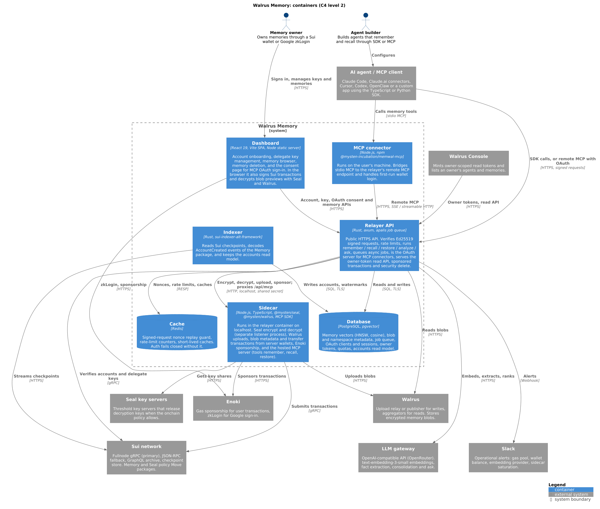
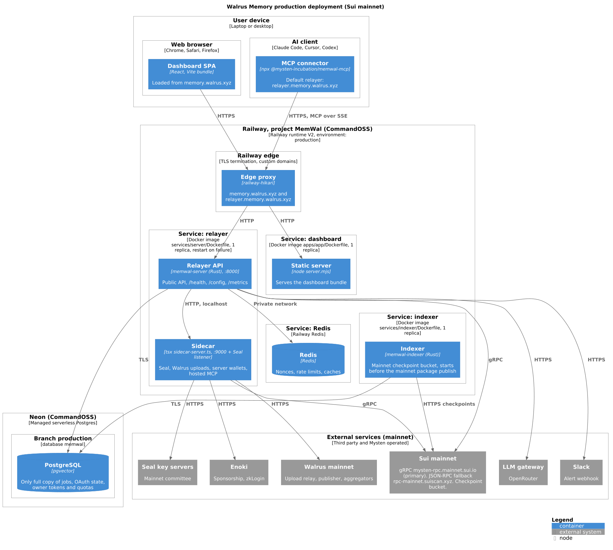
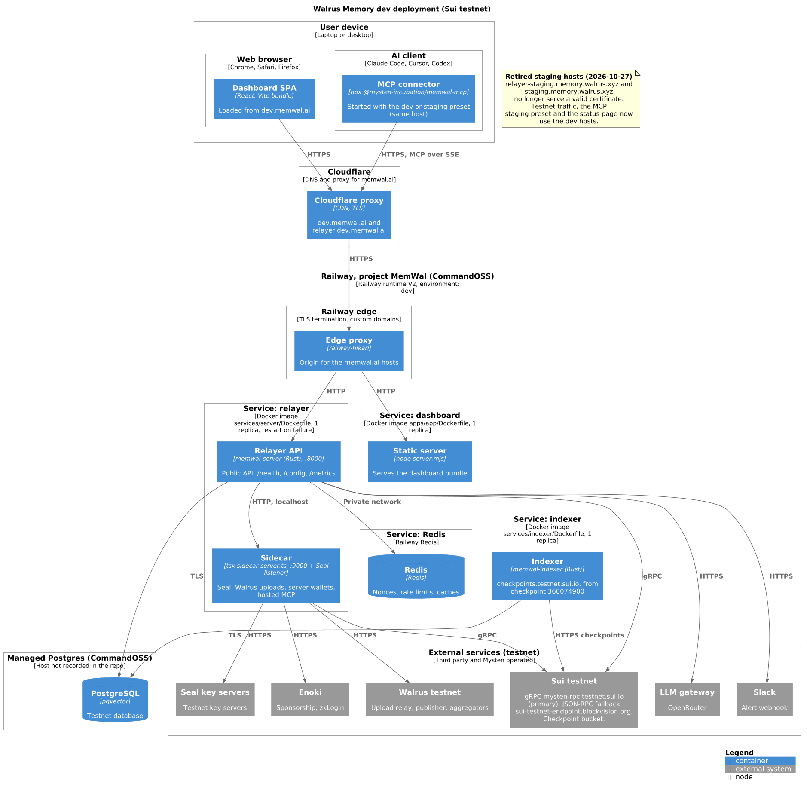

# Walrus Memory architecture

These diagrams show Walrus Memory as it runs today on CommandOSS's Railway.
They were checked against this repository and against the live `/health` and
`/config` endpoints of each relayer on 2026-11-12.

The `.puml` files are the source of truth. The `.png` files are rendered from
them; see [Rendering the diagrams](#rendering-the-diagrams).

## Containers (C4 level 2)



| Container | Code | What it does |
| --- | --- | --- |
| Relayer API | `services/server/src` (Rust, axum) | The public HTTPS API. It verifies Ed25519 signed requests and applies rate limits. It runs remember, recall, restore, analyze and ask, and queues remember jobs in Postgres with apalis. It is also the OAuth authorization server for MCP connectors, serves the owner-token read API that Walrus Console uses, sponsors transactions and runs security delete. |
| Sidecar | `services/server/scripts` (Node.js, TypeScript) | Ships in the relayer image and listens on localhost only. It does Seal encryption and decryption (in a separate listener process so uploads cannot stall recall), Walrus uploads, and blob metadata and transfer transactions signed by the server wallets, with Enoki sponsorship. It also hosts the MCP server, which the relayer proxies at `/api/mcp`. |
| Indexer | `services/indexer` (Rust, `sui-indexer-alt-framework`) | Reads Sui checkpoints from the checkpoint bucket, decodes `account::AccountCreated` events of the Memory package, and writes the `accounts` read model and its watermarks to Postgres. |
| Dashboard | `apps/app` (React, Vite) | The web app at the dashboard host. Owners sign in with a Sui wallet or Google zkLogin through Enoki, create accounts and delegate keys, browse and delete memories, and approve MCP OAuth sign-ins. |
| MCP connector | `packages/mcp` (`@mysten-incubation/memwal-mcp`) | Runs on the user's machine. It bridges an MCP client's stdio to the relayer's remote MCP endpoint and handles first-run wallet login. Claude.ai custom connectors skip it and talk to `/api/mcp` with OAuth. |
| Database | PostgreSQL with pgvector | Memory vectors (HNSW, cosine), blob and namespace metadata, the job queue, OAuth clients and sessions, owner tokens, quotas and the accounts read model. It is the only full copy of jobs, OAuth state, owner tokens and quotas: a Walrus restore brings back blobs, not these. |
| Cache | Redis | The signed-request nonce replay guard, rate-limit counters and short-lived caches. Auth fails closed when Redis is down. |

### External dependencies

| Dependency | Used by | What for |
| --- | --- | --- |
| Sui fullnode | Relayer, sidecar, dashboard | gRPC is the primary transport (`suiTransport: grpc` on both relayers). JSON-RPC is kept as a fallback, and the sidecar uses GraphQL for archive reads. |
| Sui checkpoint bucket | Indexer | Checkpoint ingestion. |
| Walrus | Sidecar (writes), relayer and dashboard (reads) | Stores the Seal-encrypted memory blobs. Writes go through the upload relay or a publisher; reads race several aggregators. |
| Seal key servers | Sidecar, dashboard | Release decryption keys when the onchain policy allows it. |
| Enoki | Sidecar, dashboard | Gas sponsorship, and zkLogin for Google sign-in. |
| LLM gateway (OpenAI-compatible, OpenRouter) | Relayer | `text-embedding-3-small` embeddings, fact extraction, consolidation, ranking and ask. |
| Slack | Relayer | Operational alerts: gas pool, wallet balance, embedding provider and sidecar saturation. |
| Walrus Console | Calls the relayer | Mints owner-scoped `memories.read` tokens and lists an owner's agents. |

## Deployments

All environments run in the Railway project `MemWal`, owned by CommandOSS.
Each Railway environment has four services built from this repository's
Dockerfiles: relayer, dashboard, indexer and Redis. In production,
Postgres is a Neon database (branch `production`, database `memwal`)
outside Railway.

| Environment | Sui network | Relayer | Dashboard | Status |
| --- | --- | --- | --- | --- |
| production | mainnet | `relayer.memory.walrus.xyz` | `memory.walrus.xyz` | Live, served by the Railway edge directly |
| dev | testnet | `relayer.dev.memwal.ai` | `dev.memwal.ai` | Live, behind Cloudflare. It is the only testnet environment. |
| staging | testnet | `relayer-staging.memory.walrus.xyz` | `staging.memory.walrus.xyz` | Retired on 2026-10-27 (#1298). The hosts no longer serve a valid certificate, and the MCP `--staging` preset and the status page point at dev. |

### Production (mainnet)



### Dev (testnet)



### Not shown

- The `apps/noter`, `apps/chatbot`, `apps/researcher` and `apps/status` apps
  have Railway configs, but their `*.demo.memwal.ai` hosts return 404 today.
- The OpenTelemetry collector in `services/server/observability` is a
  proof of concept and not part of the verified deployment.
- `deploy-app-walrus.yml` also publishes the mainnet dashboard as a Walrus
  Site on pushes to `main`. `memory.walrus.xyz` itself is served by Railway.
- Things the repository does not record: the host of the testnet database,
  the exact Railway environment names beyond `dev`, and which branch each
  environment auto-deploys from.

## Rendering the diagrams

The diagrams use C4-PlantUML from the PlantUML standard library. Render
them locally with Docker rather than a public render server. From this
directory:

```bash
docker run --rm -v "$PWD:/data" plantuml/plantuml -tpng /data/c4-container.puml /data/deployment-production.puml /data/deployment-dev.puml
```

In Git Bash on Windows, prefix the command with `MSYS_NO_PATHCONV=1`.
